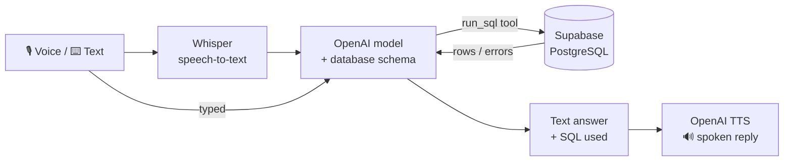

# 🎙️ Talk or Type to your Database

Ask questions about your business data in plain language, by voice or text, and get a spoken answer backed by real SQL.

**Live demo:** [voice-database-agent.streamlit.app](https://voice-database-agent.streamlit.app)

The app turns a question like *"Which product made the most revenue?"* into a PostgreSQL query, runs it against a Supabase database, and replies in a short sentence that is also read aloud. Every answer shows the exact SQL that was run and the rows it returned, so the result can always be checked.

---

## ✨ Features

- **Voice or text input.** Record a question in the browser or type it.
- **Natural-language to SQL.** An OpenAI model writes PostgreSQL from the live database schema, so new tables work without code changes.
- **Spoken answers.** Replies are converted to speech with OpenAI text-to-speech.
- **Transparent results.** A "SQL used" panel under each answer shows the query and its result table.
- **Self-correcting queries.** If a query fails, the model reads the database error, fixes the SQL and retries (up to 5 steps).
- **Multilingual.** Ask in English or Arabic, and the answer comes back in the same language.
- **Conversation memory.** Follow-up questions such as *"When was it sold?"* use earlier context.
- **Read-only by design.** The model can never change or delete data (see [Safety](#-safety)).

---

## 🏗️ How it works



1. Voice input is transcribed with **Whisper**.
2. The app loads the table and column structure from `information_schema` and gives it to the model.
3. The model calls a `run_sql` tool, using OpenAI function calling, to query the database.
4. Results go back to the model, which writes a short, natural answer.
5. The answer is shown with its SQL and result table, and is read aloud.

---

## 🛠️ Tech stack

| Layer | Technology |
|---|---|
| UI | [Streamlit](https://streamlit.io) (`st.chat_input`, `st.audio_input`) |
| AI | OpenAI API: chat model with tool calling, Whisper, TTS |
| Database | [Supabase](https://supabase.com) PostgreSQL via session pooler |
| Driver | `psycopg2` |
| Hosting | Streamlit Community Cloud |

---

## 🔒 Safety

Letting an AI write SQL against a real database needs guardrails. This app uses three layers:

1. **Read-only database user.** The app connects as `app_readonly`, which only has `SELECT` permission. Even a malicious query cannot modify data.
2. **Query validation.** Only a single `SELECT` or `WITH … SELECT` statement is accepted. Anything else is rejected before it reaches the database.
3. **Read-only transactions with a timeout.** Each query runs in a read-only session with a 10-second `statement_timeout` and a 200-row cap.

Try asking it to *"delete all sales records"*: it will refuse.

---

## 🚀 Run it yourself

### 1. Database (Supabase)

Create a project, then run [`setup_readonly_user.sql`](setup_readonly_user.sql) in the SQL editor to create the read-only user (choose your own password).

For sample data, create a `sales_data` table:

```sql
CREATE TABLE IF NOT EXISTS sales_data (
    id SERIAL PRIMARY KEY,
    product_name TEXT,
    units_sold INT,
    revenue DECIMAL(10, 2),
    sale_date DATE
);
```

Then insert a few rows of your own.

### 2. Secrets

Create `.streamlit/secrets.toml` (never commit it) or add these in **Streamlit Cloud → Settings → Secrets**:

```toml
OPENAI_API_KEY = "sk-..."
DATABASE_URL = "postgresql://app_readonly.<project-ref>:<password>@<pooler-host>:5432/postgres"
```

Get the host from **Supabase → Connect → Session pooler**. Use a password made of letters and numbers, or percent-encode special characters (for example `#` → `%23`).

### 3. Install and run

```bash
pip install -r requirements.txt
streamlit run app.py
```

---

## 💬 Example questions

- What's the most sold item?
- Which product made the most revenue?
- How much revenue did we make in February 2026?
- Show revenue by product, highest first.
- ما هو المنتج الأكثر مبيعاً؟

---

## 📁 Project structure

```
├── app.py                      # Streamlit app: UI, AI agent loop, database access
├── requirements.txt            # Python dependencies
├── setup_readonly_user.sql     # Creates the read-only Postgres user
└── secrets.toml.example        # Template for the required secrets
```

---

## 👤 Author

**Ali Abdulqawi Moqbel**, AI automation specialist and web developer
[LinkedIn](https://www.linkedin.com/in/ali-abdulqawi-398387195/)

The sample data in the demo database is fictional.
